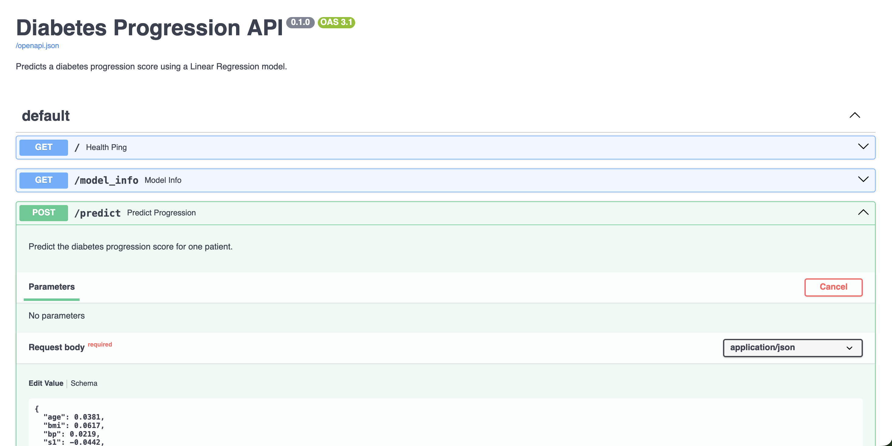
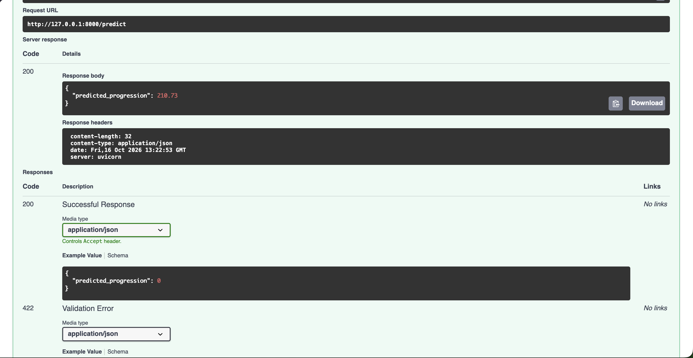

# FastAPI Lab: Diabetes Progression API

A Linear Regression model trained on the scikit-learn diabetes dataset, served as a REST API with **FastAPI** and **uvicorn**.

Based on the [FastAPI Lab](https://github.com/raminmohammadi/MLOps/tree/main/Labs/API_Labs/FastAPI_Labs) from Prof. Ramin Mohammadi's MLOps repo.

## Modifications from Original

| Original Lab | This Lab |
|---|---|
| Iris dataset | Diabetes dataset |
| Classification (3 flower species) | Regression (disease progression score) |
| Decision Tree Classifier | Linear Regression |
| Returns a class number | Returns a predicted progression score |
| 2 endpoints (`/`, `/predict`) | 3 endpoints, adding `/model_info` with test set R2 and MAE |
| Model reloaded on every request | Model loaded once when the API starts |
| Placeholder values in the docs | Real example patient prefilled in the docs |

## Setup

```bash
python3 -m venv fastapi_env
source fastapi_env/bin/activate
pip install -r fastapi_lab/requirements.txt
```

## Run

```bash
cd fastapi_lab/src
python train.py
uvicorn main:app --reload
```

Then open http://127.0.0.1:8000/docs

## Endpoints

| Method | Endpoint | Description |
|---|---|---|
| GET | `/` | Health check |
| GET | `/model_info` | Model type, dataset and test set metrics |
| POST | `/predict` | Predicted progression score for one patient |

## Input Features

All values are mean centered and scaled, as provided by scikit-learn.

| Field | Meaning |
|---|---|
| `age` | Age |
| `sex` | Sex |
| `bmi` | Body mass index |
| `bp` | Average blood pressure |
| `s1` | Total serum cholesterol |
| `s2` | Low density lipoproteins |
| `s3` | High density lipoproteins |
| `s4` | Total cholesterol to HDL ratio |
| `s5` | Log of serum triglycerides |
| `s6` | Blood sugar level |

## Results

| Metric | Value |
|---|---|
| Test set R2 | 0.4526 |
| Test set MAE | 42.79 |
| Example request prediction | 210.73 |

## Screenshots





## Project Structure

```
fastapi_lab/
├── assets/
│   ├── docs.png
│   └── predict_response.png
├── model/
│   ├── diabetes_model.pkl
│   └── metrics.json
├── src/
│   ├── __init__.py
│   ├── data.py
│   ├── main.py
│   ├── predict.py
│   └── train.py
├── README.md
└── requirements.txt
```
